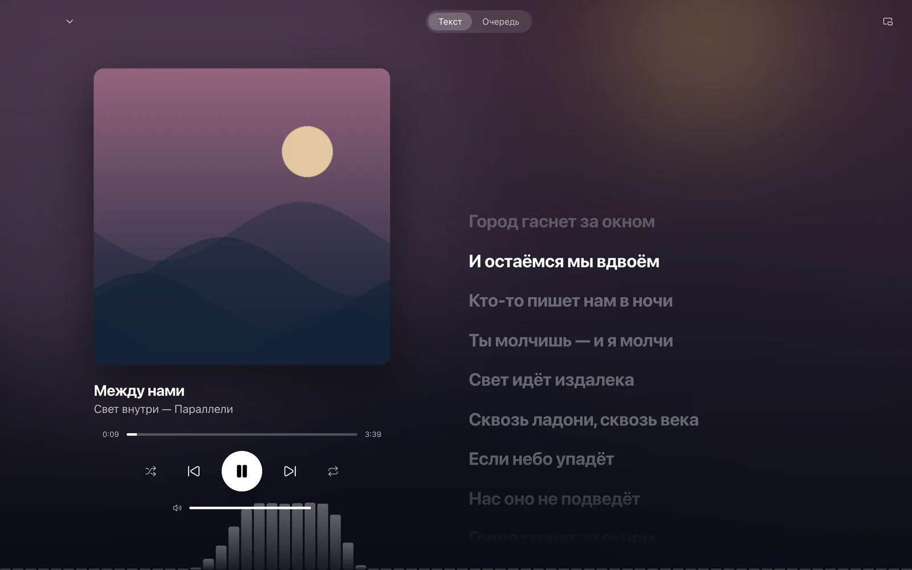

# Nocturne

[Русский](README.md) · [Website](https://nocturne.razex.online/?lang=en) · [App Store](https://apps.apple.com/app/id6814215090) · [Downloads](https://github.com/RAZEX0LOL/nocturne-releases/releases/tag/updates)

A music player for your own Navidrome/OpenSubsonic library and local files.
iPhone, iPad, Mac, Windows, Linux and Android. Free to download, with no ads or subscriptions.

## Install and listen

- **iPhone / iPad, iOS / iPadOS 17+:** [App Store](https://apps.apple.com/app/id6814215090).
- **Mac:** [Apple Silicon DMG](https://nocturne.razex.online/?lang=en#download) or [App Store](https://apps.apple.com/app/id6814215090).
- **Windows 10 / 11 x64, Linux x86-64, Android 8+:** [installers](https://nocturne.razex.online/?lang=en#download).

Connect with your server URL, username and password. Path prefixes such as
`https://music.example.com/navidrome` are supported; do not append `/rest`.

A server is optional: choose on-device music and import files or a folder.
On Android: **Library → On this phone → Files / Folder**. You do not need to disconnect
an existing server. The demo includes fictional albums, procedural artwork and original audio.

Library search, favorites, playlists, downloads, synced lyrics, optional LRCLIB lookup,
equalizer, ReplayGain and server queue synchronization are available across the clients.
Each platform has its own UI and audio engine; individual features and system integrations
vary. CarPlay requires a separate entitlement from Apple.

Official builds are published by the maintainer. Actions artifacts are development builds
and may not carry release signatures.

## Build and test

Clone the full history: `git clone https://github.com/RAZEX0LOL/nocturne.git`.
Release numbers are derived from the commit count.

- **Apple:** Swift 6, `swift test`. Xcode on macOS for iOS / iPadOS / Mac Catalyst;
  see the [Apple guide](docs/apple-development.md). Use your own team for device signing.
- **Android:** JDK 24, SDK 36, Build Tools 36.0.0;
  `cd android && ./gradlew :core:test :app:assembleDebug`.
  Set `ANDROID_HOME` or an ignored `android/local.properties`.
- **Desktop:** Bun, Rust / Cargo and Tauri platform dependencies;
  `cd desktop && bun install --frozen-lockfile && bun run build && bun test`.
  See the [desktop guide](desktop/README.md).
- **Website:** `cd site && bun install --frozen-lockfile && bun run build`.

The maintainer's signing keys are not required for development. Swift core has no external
package dependencies. On a configured Mac, `python3 scripts/verify.py` runs core tests,
builds and desktop e2e. Install Playwright Chromium and keep ports 4533 / 1431 free.
Set `CHROME` to the installed Chromium executable; see the desktop guide for browser setup.
Reports are written to `build/verification/`.

## Contribute and license

[Contributing](CONTRIBUTING.md) · [Security](SECURITY.md) · [Privacy](https://nocturne.razex.online/privacy?lang=en)

Never include credentials, private music or authenticated streaming URLs in reports.

Original code is licensed under [PolyForm Noncommercial 1.0.0](LICENSE).
Use, modification and redistribution are permitted for the noncommercial purposes defined
by that license, with the required notices preserved. Commercial use is not granted;
contact the copyright holder for separate permission.

This is source-available software with a noncommercial restriction, not OSI-licensed
open-source software. Dependencies retain their own licenses:
[third-party notices](THIRD_PARTY_NOTICES.md).
