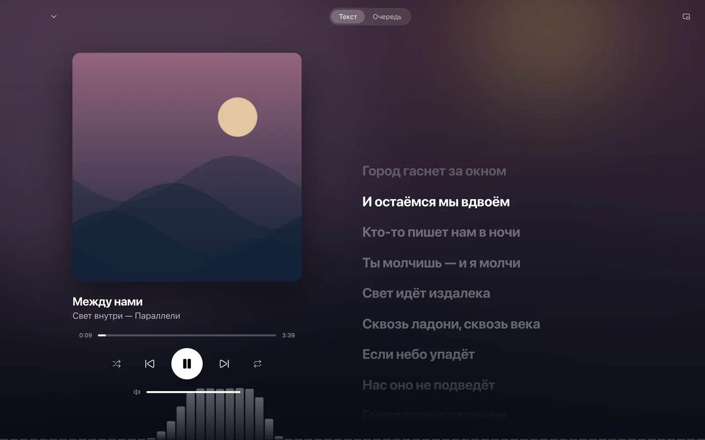

# Nocturne Player

[English](README.en.md) · [Сайт](https://nocturne.razex.online) · [App Store](https://apps.apple.com/app/id6814215090) · [Установщики](https://github.com/RAZEX0LOL/nocturne-releases/releases/tag/updates)

Плеер для своей медиатеки Navidrome/OpenSubsonic и локальных файлов.
iPhone, iPad, Mac, Windows, Linux и Android. Бесплатное приложение без рекламы и подписок.

## Установка

| Платформа | Где скачать |
|---|---|
| iPhone / iPad, iOS / iPadOS 17+ | [App Store](https://apps.apple.com/app/id6814215090) |
| Mac | [DMG для Apple Silicon](https://nocturne.razex.online/#download) или [App Store](https://apps.apple.com/app/id6814215090) |
| Windows 10 / 11 x64, Linux x86-64, Android 8+ | [Установщики на сайте](https://nocturne.razex.online/#download) |

Официальные сборки публикует автор. Артефакты Actions предназначены для проверки
разработки и могут не иметь релизной подписи.

## Начать слушать

- **Со своим сервером:** введи адрес Navidrome, логин и пароль. Поддерживается префикс
  пути: `https://music.example.com/navidrome`. `/rest` добавлять не нужно.
- **Без сервера:** выбери музыку с устройства на экране входа и добавь файлы или папку.
  На Android: «Медиатека → На телефоне → Файлы / Папка». Подключённый сервер отключать не нужно.
- **Попробовать:** «Посмотреть демоверсию» открывает вымышленные альбомы,
  процедурные обложки и оригинальные аудиопримеры. Свой сервер не нужен.

[Настройка Navidrome](https://nocturne.razex.online/start) · [Помощь](https://nocturne.razex.online/support)

## Возможности

Медиатека, поиск, избранное, плейлисты, очередь, локальные файлы и офлайн-загрузки.
Синхронные тексты, необязательный поиск в LRCLIB, эквалайзер, ReplayGain, сохранение
очереди на сервере и продолжение на другом устройстве. Фоновое воспроизведение,
системные медиакнопки, темы, русский и английский интерфейс.

У платформ отдельные интерфейсы и аудиодвижки; системные интеграции и отдельные
функции могут различаться. CarPlay требует отдельного разрешения Apple.

## Исходники и сборка

Клонируй с историей: `git clone https://github.com/RAZEX0LOL/nocturne-player.git`.
Скрипты выпуска вычисляют номер сборки по числу коммитов.

| Часть | Требования | Проверка |
|---|---|---|
| `Nocturne/`, `NocturneWidget/` | Swift 6, SwiftUI, AVQueuePlayer; Xcode на macOS | `swift test`; [Apple](docs/apple-development.md) |
| `android/` | Kotlin, Compose, Media3; JDK 24, SDK 36, Build Tools 36.0.0 | [Android](android/README.md) |
| `desktop/` | Tauri 2, Rust, React, TypeScript, Web Audio; Bun, Rust / Cargo | [Desktop](desktop/README.md) |
| `site/` | Vite, React, Tailwind; Bun | `cd site && bun install --frozen-lockfile && bun run build` |
| `shared/` | Контрактные сценарии и локальный мок Subsonic | [Общий контракт](shared/README.md) |

Для Android задай SDK через `ANDROID_HOME` или игнорируемый `android/local.properties`.
Для Apple-сборки на своём устройстве выбери собственную команду и идентификаторы приложения.
Ключи автора для разработки не нужны. Ядро Swift не имеет сторонних зависимостей.

После установки зависимостей на Mac: `python3 scripts/verify.py` — ядра, сборки,
сайт и desktop e2e. Нужны Chromium для Playwright и свободные порты 4533 / 1431.
Результаты — в `build/verification/`. Все desktop e2e принимают `CHROME` — абсолютный
путь к установленному Chromium. Установка браузера и отдельные команды описаны в README платформ.

## Участие

[Внести изменения](CONTRIBUTING.md) · [Сообщить об уязвимости](SECURITY.md) ·
[Конфиденциальность](https://nocturne.razex.online/privacy)

Ошибки и предложения — через Issues. Не публикуй пароли, ключи, личную музыку
или полные сетевые трассировки: URL Subsonic содержат токены авторизации.

## Лицензия

Собственный код — [PolyForm Noncommercial 1.0.0](LICENSE): использование,
изменение и распространение для разрешённых некоммерческих целей с сохранением
обязательных уведомлений. Коммерческое использование этим репозиторием не разрешается;
за отдельным разрешением нужно обращаться к правообладателю.

Это публично доступный код с некоммерческим ограничением, а не лицензия Open Source OSI.
Сторонние компоненты сохраняют свои лицензии: [уведомления](THIRD_PARTY_NOTICES.md).
